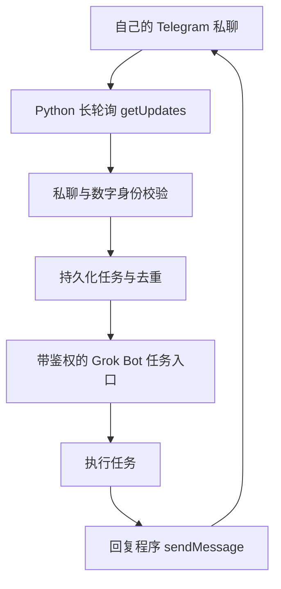

# Telegram × Grok Bot 接入教程

通过 Telegram 私聊向自己的 Grok Bot 提交任务，并在任务完成后收到回复。

这是面向初学者的中文教程和提示词仓库。按文档让自己的助手生成适合当前环境的桥接程序，再完成配置与验收。仓库不包含可直接运行的桥接服务，也不包含任何真实账号、密钥或原作者的部署记录。

## 从这里开始

1. 阅读 [前置条件](docs/01-prerequisites.md)，确认环境满足要求。
2. 复制 [完整部署提示词](prompts/setup-prompt.md)，发送给自己的 Grok Bot。
3. 按助手指引创建机器人、安全配置密钥、确认绑定身份。
4. 依照 [验收清单](docs/07-test-and-troubleshoot.md)检查真实结果。

**不要把 Token、Webhook 地址或密钥发到 GitHub Issue、聊天或截图中。**

## 工作原理

Telegram 接收端使用长轮询；Grok Bot Webhook 是转发程序提交任务的目标，两者不是同一个入口。此设计只需要桥接程序主动访问外部 HTTPS 服务，不要求公网入站端口。

任务入口是否可用、请求格式和后台运行条件，取决于使用者的平台版本、权限和实际环境。先检查，再配置。

## 教程导航

| 文档 | 内容 |
| --- | --- |
| [01 前置条件](docs/01-prerequisites.md) | 环境、权限和能力检查 |
| [02 创建 Telegram Bot](docs/02-create-telegram-bot.md) | BotFather、安全配置、验证 |
| [03 配置任务入口](docs/03-configure-task-entry.md) | Routine、鉴权与状态 |
| [04 转发和回复](docs/04-forward-and-reply.md) | 实现要求、去重和回传 |
| [05 绑定和权限](docs/05-bind-and-secure.md) | 身份确认、私聊限制 |
| [06 运行和恢复](docs/06-run-and-recover.md) | 常驻、备份和恢复 |
| [07 验收和排障](docs/07-test-and-troubleshoot.md) | 测试清单、故障定位 |
| [部署提示词](prompts/setup-prompt.md) | 交给自己的 Grok Bot 实施 |
| [Routine 提示词](prompts/routine-prompt.md) | 任务入口指令模板 |
| [配置模板](.env.example) | 空值示例；不是完整服务配置 |
| [隐私说明](PRIVACY.md) | 分享内容和故障反馈的边界 |

## 需要准备

- 自己的 Telegram 账号和机器人。
- 可以运行 Python、保存状态并访问外部 HTTPS 的部署设备。
- 具有任务入口、执行工具和回传能力的 Grok Bot 环境。
- 一个可信的管理入口，用于确认绑定和处理必要授权。

电脑常开、VPS 或平台云端电脑都可以作为候选运行环境，具体按实际条件选择。教程不承诺永久在线，也不提供共享机器人。

## 配置模板

将 `.env.example` 复制为 `.env`，在部署设备上自行填写。模板列出建议字段，实际程序需要明确支持这些字段和加载方式。复制模板本身不会完成部署。

只有非敏感信息可以放入公开文档；真实数字身份和运行配置保留在自己的部署环境中。

## 验证状态

本仓库已整理教程与模板。使用者的 Token、Routine、账号绑定、任务执行和消息回传都需要在自己的环境实测。文档检查通过不代表端到端接入成功。

## 官方资料

- [Telegram Bot API](https://core.telegram.org/bots/api)
- [Telegram BotFather](https://core.telegram.org/bots/features#botfather)
- [Grok Bot Skills and routines](https://docs.x.ai/grok-bot/skills-routines-and-automations)

资料核对日期：2026-10-12。Grok Bot 官方 Routine 说明不足以验证本教程需要的完整 Webhook 协议，因此协议和入口仍需在当前平台核实。

教程与提示词使用 [MIT License](LICENSE)。欢迎改进通用步骤；提交反馈前请先脱敏。
